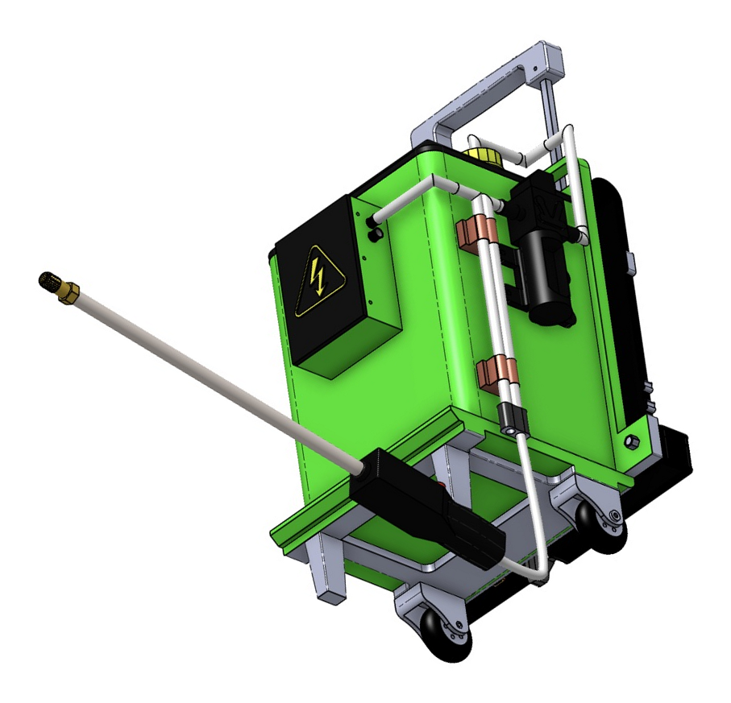

# Portable mechatronic aguamiel extractor

Technical files for the extractor: mechanical CAD, electronic diagrams, Arduino reference code, Wokwi control simulation, analytical MATLAB calculations.

## CAD

- [Interactive Onshape assembly (read only)](https://cad.onshape.com/documents/8d63edc8556e8467e15e8813/w/f6cf07018f7e5b17799cff25/e/69101facf2e8677662560864)
- [Native CAD package and instructions](cad/)
- [Assembled STEP](cad/Aguamiel_Extractor_Assembly.step)

## Electronics and software

- [Portable Fritzing file and opening instructions](electronics/fritzing/)
- [Arduino Nano program and downloadable sketch folder](firmware/ExtractorAguamiel/)
- [Run the Wokwi control simulation](https://wokwi.com/projects/479154932505587713)
- [Wokwi source, diagram and downloadable project](simulation/wokwi/)
- [Proteus basic-operation project, firmware and demonstration video](simulation/proteus/)

## MATLAB calculations

- [Run the MATLAB script](reproducibility/reproduce_calculations.m)
- [Generated graphs and CSV results](reproducibility/)

The script generates three graphs (PNG and SVG) and four CSV files in the same folder.

The calculations are analytical scenarios, not measurements. The control program estimates volume from time and a configured reference flow; it does not measure liquid level or flow. CAD, diagrams and software checks do not establish physical performance, structural strength or food-contact suitability.

## Rights

No repository-wide license has been selected. Existing authorship and third-party rights remain applicable.

## Review access

This technical snapshot is publicly accessible to facilitate peer review. Continued public availability will be reassessed following the final editorial decision.

## Illustrative filling video

- [Watch or download the 1080p MP4](simulation/flow_visualization/Aguamiel_Extractor_Filling_Animation_1080p.mp4).
- [Animation description and limitations](simulation/flow_visualization).

The video shows the upright extractor and an animated level in a 10 L reference container. It is an illustrative CAD animation with accelerated playback, not a CFD analysis or experimental validation.
