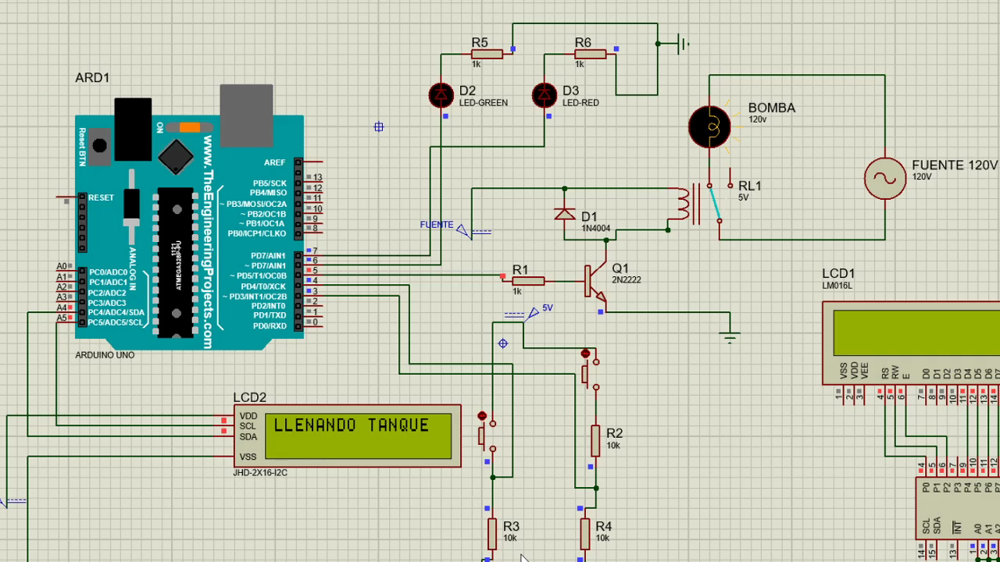

# Proteus basic-operation demostration

Original Proteus circuit and user-supplied recording of its basic START/STOP operation. This historical demonstration is separate from the current Nano firmware, Fritzing hardware documentation and Wokwi simulation.

- [Watch or download the original demonstration video](Proteus_basic_operation.mp4)
- [Download the project, firmware source, HEX, library source and backups](Proteus_basic_operation_package.zip)
- [Native Proteus project](prototipo.pdsprj)
- [Recompiled Uno program](PROGRAMACION.ino.hex)

## Open and configure

1. Extract the package into a local folder. Open `prototipo.pdsprj` in a licensed Proteus installation with AVR VSM support. Proteus itself is not included.
2. Open the properties of Arduino `ARD1`. Replace its obsolete temporary Windows **Program File** path with the supplied `PROGRAMACION.ino.hex`. Keep the 16 MHz clock.
3. The project identifies a third-party Arduino Uno model from TheEngineeringProjects.com. Its device data is present in the design; no separate `.LIB` or `.IDX` was supplied. If Proteus reports a missing model, resolve that installation dependency before running. Native Proteus model references include `AVR2.DLL`, `LCDALPHA`, `ACTVRLY` and `DIODESINC`; these are not bundled.
4. Retain the original button configuration: START on D4 and STOP on D3 are active HIGH with external pull-down paths. D5 drives the transistor/relay, D6 the green LED and D7 the red LED. The LCD uses A4/SDA and A5/SCL.
5. Run the simulation. The basic program displays `ESPERANDO PULSO / PARA EXTRACCION`, activates switching after START, displays `LLENANDO TANQUE / DE AGUAMIEL`, and returns to standby after STOP. It includes blocking delays and has no timed-volume cutoff.

The project uses `JHD-2X16-I2C` with `DVCADDR=$7C`. The DFRobot library uses the corresponding 7-bit LCD address `0x3E`. Its RGB commands target a separate address; an RGB controller is not established by the supplied LCD-only model.

## Firmware provenance and compilation

The supplied `PROGRAMACION.ino` contained the basic pump-control sketch followed by an unrelated Memsic2125 accelerometer example, including duplicate `setup()` and `loop()` definitions. The unmodified file is retained under `original/` in the package and does not compile as supplied.

`PROGRAMACION/PROGRAMACION.ino` removes only that appended example. The pump-control statements are retained. It compiled for `arduino:avr:uno` using Arduino AVR Boards 1.8.6: **3794 bytes flash; 314 bytes SRAM**. The supplied HEX is newly compiled from this extracted sketch; it is not the recovered historical binary used to record the video.

The package includes unchanged source for [DFRobot_LCD](https://github.com/DFRobotdl/DFRobot_LCD), including its original copyright and GNU Lesser General Public License notices, plus the upstream source ZIP. Install `libraries/DFRobot_LCD` in the Arduino libraries folder to rebuild. Arduino `Wire` is also required.

## Verification scope

In the recording and saved design, the load named `BOMBA` is a lamp model labelled 120 V, driven from a sinusoidal source. It illustrates relay switching and is not a model of the physical 12 V diaphragm pump or its hydraulic performance. The saved design also contains legacy supply/model settings; this folder preserves them and is not the wiring reference for the 12 V prototype. Use the Fritzing folder for current hardware documentation.

The workstation-specific workspace file is omitted because it stores editor layout rather than the circuit/firmware. Native project and backup files are otherwise preserved without circuit changes.
